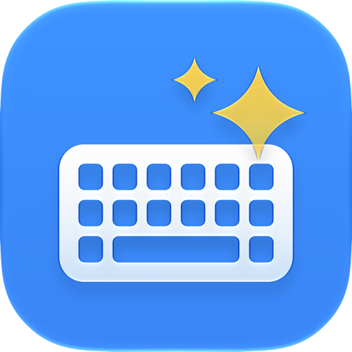
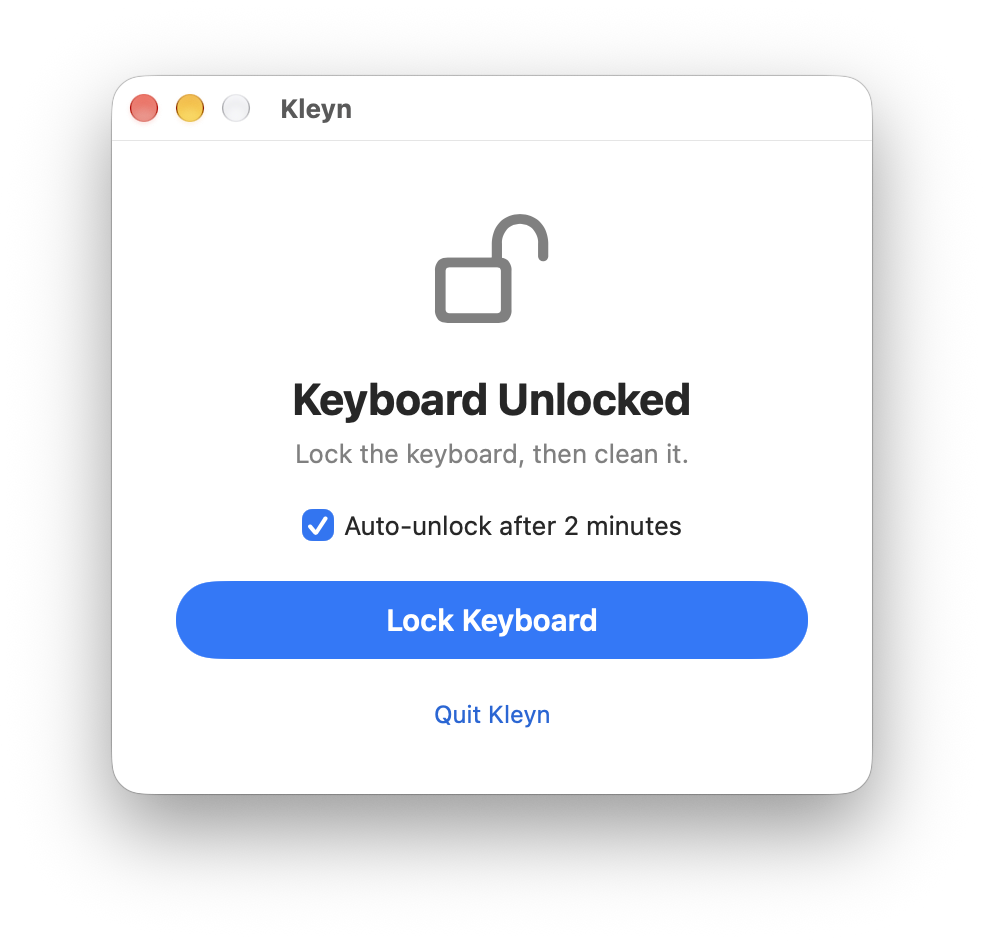
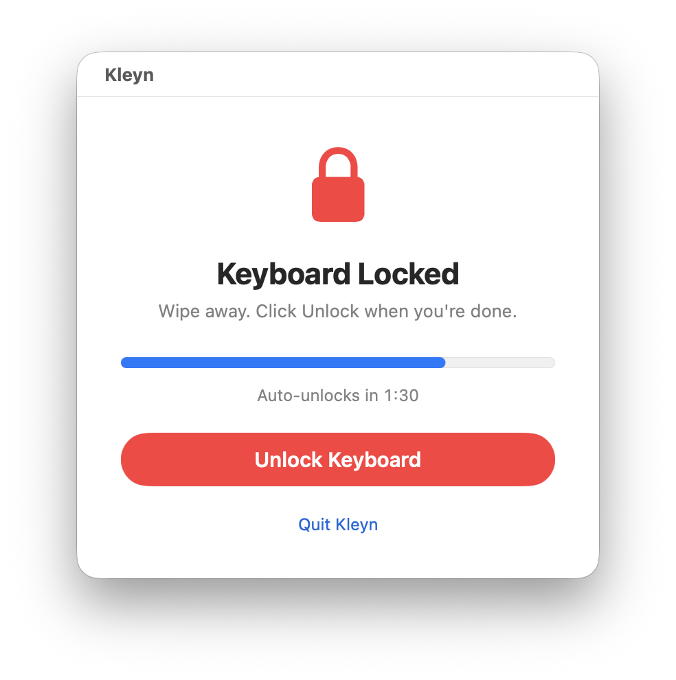

<p align="center">
  
</p>

<h1 align="center">Kleyn – Keyboard Cleaning</h1>

<p align="center">
  A tiny macOS utility that temporarily locks your keyboard so you can wipe it clean<br>
  without typing garbage or triggering shortcuts.
</p>

<p align="center">
  
  
</p>

## Features

- **One-click lock.** Blocks all keyboard input system-wide: regular keys, modifiers, the Globe/fn key, and media, volume, brightness and keyboard-backlight keys.
- **Unlock with the mouse.** Click **Unlock Keyboard** with your mouse or trackpad when you're done.
- **No accidental shortcuts.** While locked, modifier keys you press while wiping are stripped from clicks, so a click never turns into a ⌘-click or a right-click.
- **Safety net.** An optional auto-unlock after 2 minutes, with a visible countdown. On by default, and remembered between launches.
- **Can't lose the button.** The window can't be closed or minimized while the keyboard is locked.
- **Fails safe.** Quitting Kleyn, or Kleyn crashing, always releases the keyboard.
- **Small and dependency-free.** Pure Swift and SwiftUI, no third-party code.

## Requirements

- macOS 27 or later
- The **Accessibility** permission (see below)

## Usage

1. Open Kleyn and click **Lock Keyboard**.
2. Clean your keyboard.
3. Click **Unlock Keyboard**, or wait for the auto-unlock.

Kleyn keeps running after you unlock, so you can lock again any time. Quit with ⌘Q or **Quit Kleyn**.

### Granting Accessibility access

macOS only lets apps with Accessibility access block keyboard input. Until it's granted, Kleyn shows a banner with instructions:

1. Click **Open System Settings** in Kleyn (or go to **System Settings → Privacy & Security → Accessibility**).
2. Turn on **Kleyn**. If it isn't listed, add it with **+**.
3. Return to Kleyn. The banner disappears on its own, with no relaunch needed.

> [!TIP]
> If Kleyn is enabled but still can't lock, remove it from the Accessibility list, add it again, and relaunch. This can happen after switching between differently signed builds (for example, a Debug build and a release build), because macOS treats them as different apps.

## Limitations

Some keys are handled below the level any app can intercept:

- **Touch ID / power button:** pressing it can still sleep the display or lock the Mac.
- **Caps Lock:** the light and state may still toggle, even though the key event itself is blocked.
- **Secure Keyboard Entry:** when another app has it turned on (some terminals and password managers), macOS hides keystrokes from Kleyn. Kleyn shows a warning while locked if it detects this.

## How it works

Kleyn installs an active [`CGEventTap`](https://developer.apple.com/documentation/coregraphics/cgevent) at the HID level, before the system handles shortcuts like ⌘Tab or Force Quit. While locked, it drops key-down, key-up and modifier events, plus the system-defined events behind the media and hardware keys. Mouse and trackpad events pass through, with modifier flags removed.

The tap belongs to Kleyn's process, so the system removes it as soon as Kleyn exits. Taking exclusive control of the keyboard device through IOKit was ruled out: on current macOS that needs root, which would mean shipping a privileged helper.

All the locking logic is in [`KeyboardLocker.swift`](Kleyn/KeyboardLocker.swift).

## Building

Open `Kleyn.xcodeproj` in Xcode 27 or later and run the **Kleyn** scheme, or build from the command line:

```sh
xcodebuild -project Kleyn.xcodeproj -scheme Kleyn -configuration Release build
```

To build with your own Apple developer account, change the team under **Signing & Capabilities**.

### Distribution

Kleyn is meant to be distributed outside the Mac App Store as a notarized Developer ID app:

- **App Sandbox is off.** Active event taps aren't allowed in the sandbox.
- **Hardened Runtime is on**, with no exceptions.
- **Release builds don't add the `get-task-allow` entitlement**, which notarization rejects.

To ship a build, choose **Product → Archive**, then **Distribute App → Direct Distribution**. Xcode signs with your Developer ID, notarizes the app and staples the ticket.

## Project layout

| Path | Contents |
|---|---|
| `Kleyn/KeyboardLocker.swift` | Event tap, auto-unlock countdown, permission checks |
| `Kleyn/ContentView.swift` | The window's interface |
| `Kleyn/KleynApp.swift` | App entry point |
| `Kleyn/AppIcon.icon` | Icon Composer app icon |
| `Design/Icon/` | Source SVG layers for the icon |

## License

Kleyn is available under the [MIT License](LICENSE).
