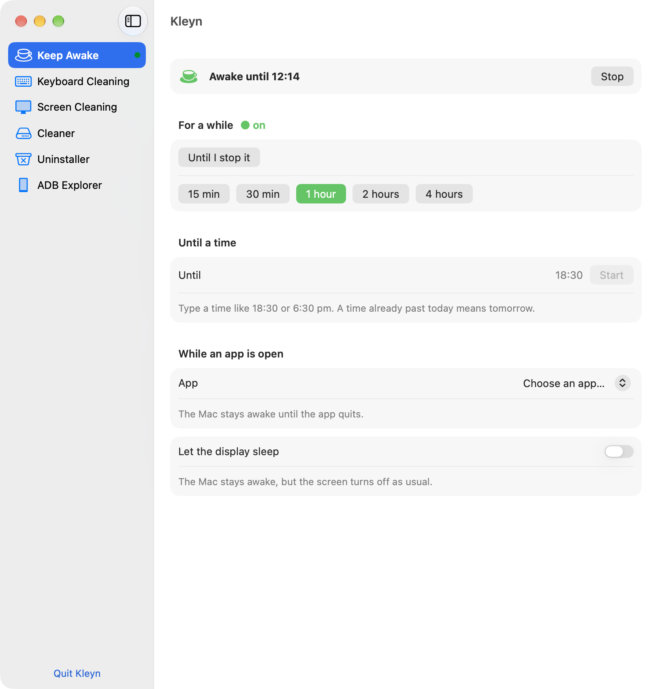
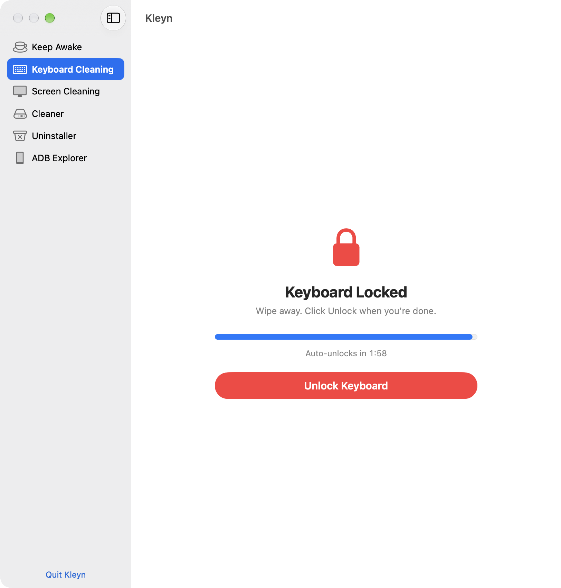
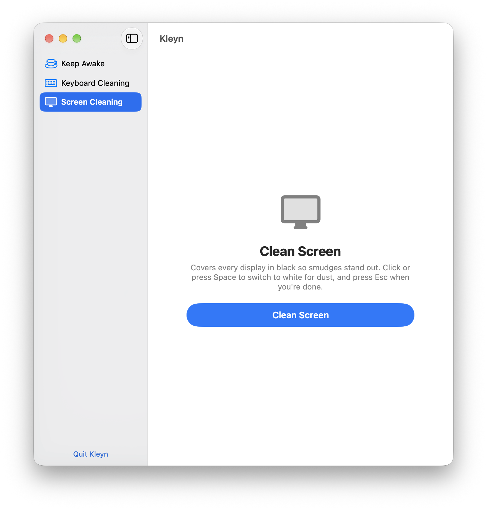

<p align="center">
  
</p>

<h1 align="center">Kleyn</h1>

<p align="center">
  A small Mac app of everyday utilities: keep your Mac awake, free up space,<br>
  lock the keyboard while you wipe it, and black out the screen to spot smudges.
</p>

<p align="center">
  
  
  
</p>

## Features

- **One-click lock.** Blocks all keyboard input system-wide: regular keys, modifiers, the Globe/fn key, and media, volume, brightness and keyboard-backlight keys.
- **Unlock with the mouse.** Click **Unlock Keyboard** with your mouse or trackpad when you're done.
- **No accidental shortcuts.** While locked, modifier keys you press while wiping are stripped from clicks, so a click never turns into a ⌘-click or a right-click.
- **Safety net.** An optional auto-unlock after 2 minutes, with a visible countdown. On by default, and remembered between launches.
- **Can't lose the button.** The window can't be closed or minimized while the keyboard is locked.
- **Fails safe.** Quitting Kleyn, or Kleyn crashing, always releases the keyboard.
- **Screen cleaning.** Covers every display, including the menu bar and Dock, in black so smudges and streaks stand out. Click or press Space to switch to white, which shows dust better. Press Esc to finish. Nothing is locked, and no permission is needed.
- **Keep Awake.** Keeps your Mac from sleeping until you stop it, for 15 minutes to 4 hours, until a time you type, or while an app runs. You can let the display sleep meanwhile. A cup icon in the menu bar shows what's on, even after you close the window. No permission needed.
- **Cleaner.** Measures the usual space users in your home folder (app caches, logs, Xcode, Gradle, Android emulators and system images, npm, CocoaPods, and Java heap dumps) and moves what you mark to the Trash, where Put Back works. Nothing is deleted, every move asks first, and places like iCloud Drive, Mail, Photos and Keychains are always refused.
- **Small and dependency-free.** Pure Swift and SwiftUI, no third-party code.

## Requirements

- macOS 27 or later on a Mac with Apple silicon
- The **Accessibility** permission for the keyboard lock (see below). Screen cleaning, Keep Awake and the Cleaner need no permission.
- Optional: **Full Disk Access** lets the Cleaner measure a few protected folders. Without it, those sizes come out low, and the Cleaner says so.

## Download

Download the latest **Kleyn-*version*.dmg** from the [Releases page](https://github.com/tyastonotaufiq/kleyn/releases/latest). Open it, drag **Kleyn** onto **Applications**, and open Kleyn from Applications. Kleyn is signed with Developer ID and notarized by Apple, so macOS opens it without a warning.

## Usage

1. Open Kleyn, choose **Keyboard Cleaning** in the sidebar, and click **Lock Keyboard**.
2. Clean your keyboard.
3. Click **Unlock Keyboard**, or wait for the auto-unlock.

Kleyn keeps running after you unlock, so you can lock again any time. While the keyboard is locked, Kleyn stays on the Keyboard Cleaning page. Quit with ⌘Q, **Quit Kleyn** at the bottom of the sidebar, or by closing the window.

### Cleaning the screen

1. Choose **Screen Cleaning** in the sidebar and click **Clean Screen**. Every display turns black.
2. Wipe the screen. Click or press Space to switch between black and white.
3. Press Esc when you're done.

Screen cleaning also ends if you switch to another app. **Clean Screen** isn't available while the keyboard is locked, because the lock would block Esc.

### Keeping your Mac awake

Choose **Keep Awake** in the sidebar, then pick one:

- **For a while:** **Until I stop it**, or 15 min, 30 min, 1 hour, 2 hours or 4 hours.
- **Until a time:** type a time like `18:30`, `6:30 pm` or `6pm` and press Return. A time already past today means tomorrow.
- **While an app is open:** choose an app. The Mac stays awake until that app quits.

Starting another one replaces the one running. Turn on **Let the display sleep** to keep the Mac awake with the screen off.

While Keep Awake is on, a cup icon in the menu bar shows what's on, with **Stop Keeping Awake** and **Open Kleyn**. Closing the window then keeps Kleyn running in the menu bar; it quits once Keep Awake ends. Quitting Kleyn ends Keep Awake, and your Mac sleeps as usual again.

### Freeing up space

Choose **Cleaner** in the sidebar. It measures the usual places the first time you open it; rows appear as each folder is measured, and the line at the top shows progress and the folder it's still waiting on. With large caches the scan can take about a minute. Click **Rescan** (⌘R) for fresh sizes.

Rows come in two groups:

- **Safe to remove:** things that are rebuilt automatically, like caches and build output. **Mark All** marks every one of them.
- **Review first:** things you may still want, like Xcode archives, Android emulators and system images.

Items under 10 MB don't get a row of their own. They're added up per category into one row, like `122 items under 10 MB in ~/Library/Caches`, which appears once the total reaches 10 MB. Moving that row moves each of those items to the Trash, never the folder that holds them.

Mark the rows to remove and click **Move to Trash** (⌘⌫). Kleyn asks first, naming how many items and how much space. You get the space back when you empty the Trash. You can mark rows while a scan runs, and move them once it's done. **Show in Finder**, or a row's context menu, shows the items in Finder.

Quit an app before moving its cache, or it may recreate the files right away. The first Gradle build after clearing `~/.gradle/caches` downloads dependencies again.

#### Safety

- **Nothing is deleted.** Items go to the Trash, where Put Back works.
- Every move asks first, naming the item count and size.
- Only items inside your home folder can be moved, and never a folder directly in it (like `~/Downloads`) or a hidden file there (like `~/.zshrc`). iCloud Drive, Mail, Messages, the Photos library, Keychains, `~/Library/Containers` and `~/.ssh` are always refused. Each path is checked again right before it moves.
- The scan never looks inside Desktop, Documents, Downloads or your other folders, and it leaves out the Music app's caches, so it doesn't make macOS ask for any access.
- Every move is logged in `~/Library/Application Support/Kleyn/cleaner-log.json` (the last 200).

#### Full Disk Access

macOS protects a few folders, and the Cleaner can't measure them without Full Disk Access. If a scan hits one, the page says so and offers **Open System Settings**. Turn on **Kleyn** under **Privacy & Security → Full Disk Access**, then rescan. Kleyn works without it; a few sizes are just lower than they should be.

### Granting Accessibility access

macOS only lets apps with Accessibility access block keyboard input. On macOS 27, System Settings lists these apps under **Device Control and Data Access**. Until access is granted, Kleyn shows a banner with instructions:

1. Click **Open System Settings** in Kleyn (or go to **System Settings → Privacy & Security → Device Control and Data Access**).
2. Turn on **Kleyn**. If it isn't listed, add it with **+**.
3. Return to Kleyn. The banner disappears on its own, with no relaunch needed.

> [!TIP]
> If Kleyn is enabled but still can't lock, remove it from the **Device Control and Data Access** list, add it again, and relaunch. This can happen after switching between differently signed builds (for example, a Debug build and a release build), because macOS treats them as different apps.

## Limitations

Some keys are handled below the level any app can intercept:

- **Touch ID / power button:** pressing it can still sleep the display or lock the Mac.
- **Caps Lock:** the light and state may still toggle, even though the key event itself is blocked.
- **Keep Awake and the lid:** closing a MacBook's lid still puts it to sleep, unless an external display, keyboard and power are connected.
- **Secure Keyboard Entry:** when another app has it turned on (some terminals and password managers), macOS hides keystrokes from Kleyn. Kleyn shows a warning while locked if it detects this.

## How it works

Kleyn installs an active [`CGEventTap`](https://developer.apple.com/documentation/coregraphics/cgevent) at the HID level, before the system handles shortcuts like ⌘Tab or Force Quit. While locked, it drops key-down, key-up and modifier events, plus the system-defined events behind the media and hardware keys. Mouse and trackpad events pass through, with modifier flags removed.

The tap belongs to Kleyn's process, so the system removes it as soon as Kleyn exits. Taking exclusive control of the keyboard device through IOKit was ruled out: on current macOS that needs root, which would mean shipping a privileged helper.

All the locking logic is in [`KeyboardLocker.swift`](Kleyn/KeyboardLocker.swift).

Screen cleaning uses one borderless window per display, above the menu bar and Dock, and doesn't touch the keyboard lock. Those windows handle Esc, Space and clicks themselves; other keys are ignored, and ⌘ shortcuts like ⌘Q still work. The code is in [`ScreenCleaner.swift`](Kleyn/ScreenCleaner.swift).

Keep Awake holds IOKit power assertions, the same ones `caffeinate -i` and `-d` take: one against idle system sleep, and one against idle display sleep unless the display may sleep. They belong to Kleyn's process, so macOS drops them when Kleyn quits or crashes. The code is in [`KeepAwake.swift`](Kleyn/KeepAwake.swift), and the parts without I/O (typed times, labels, which apps to list) are in [`KeepAwakeRules.swift`](Kleyn/KeepAwakeRules.swift), ported from the [Mac Caffeinater](https://github.com/tyastonotaufiq/claude-mods/tree/main/mac-caffeinater) mod.

The Cleaner measures each folder itself, adding up the disk space of every file inside the way `du` does, four folders at a time and off the main thread. It moves items with `FileManager.trashItem`. The code is in [`Cleaner.swift`](Kleyn/Cleaner.swift), and the parts without I/O (what's scanned, how results become rows, what may be moved) are in [`CleanerRules.swift`](Kleyn/CleanerRules.swift), ported from the [Mac Cleaner](https://github.com/tyastonotaufiq/claude-mods/tree/main/mac-cleaner) mod.

## Building

Open `Kleyn.xcodeproj` in Xcode 27 or later and run the **Kleyn** scheme, or build from the command line:

```sh
xcodebuild -project Kleyn.xcodeproj -scheme Kleyn -configuration Release build
```

To build with your own Apple developer account, change the team under **Signing & Capabilities**.

Run the tests with **Product → Test** (⌘U) in Xcode, or:

```sh
xcodebuild test -project Kleyn.xcodeproj -scheme Kleyn -destination 'platform=macOS'
```

### Distribution

The project is set up for direct distribution as a notarized Developer ID app:

- **App Sandbox is off.** The keyboard lock does work in the sandbox, but macOS never shows the Accessibility prompt to sandboxed apps, so users would have to find Kleyn and add it to the list by hand. With the sandbox off, clicking **Lock Keyboard** the first time brings up the system prompt instead.
- **Hardened Runtime is on**, with no exceptions.
- **Release builds don't add the `get-task-allow` entitlement**, which notarization rejects.

To ship a build, choose **Product → Archive**, then **Distribute App → Direct Distribution**. Xcode signs with your Developer ID, notarizes the app and staples the ticket.

To package the exported app as a DMG with the drag-to-Applications window, set up [dmgbuild](https://github.com/dmgbuild/dmgbuild) once, then run the script:

```sh
python3 -m venv .venv && .venv/bin/pip install dmgbuild
scripts/make-dmg.sh path/to/Kleyn.app    # writes Kleyn-<version>.dmg next to the app
```

The DMG isn't signed by the script. Sign and notarize it before shipping.

## Project layout

| Path | Contents |
|---|---|
| `Kleyn/KeyboardLocker.swift` | Event tap, auto-unlock countdown, permission checks |
| `Kleyn/ScreenCleaner.swift` | Full-screen black/white windows for screen cleaning |
| `Kleyn/KeepAwake.swift` | Power assertions and the session for Keep Awake |
| `Kleyn/KeepAwakeRules.swift` | Keep Awake's rules without I/O: typed times, labels, which apps to list |
| `Kleyn/Cleaner.swift` | Scanning, marking and moving to the Trash for the Cleaner |
| `Kleyn/CleanerRules.swift` | The Cleaner's rules without I/O: scan targets, rows, what may be moved |
| `Kleyn/ContentView.swift` | The window: sidebar and pages |
| `Kleyn/KeyboardView.swift`, `ScreenView.swift`, `KeepAwakeView.swift`, `CleanerView.swift` | The Keyboard, Screen, Keep Awake and Cleaner pages |
| `Kleyn/KleynApp.swift` | App entry point and the Keep Awake menu bar icon |
| `KleynTests/` | Unit tests (Swift Testing) |
| `Kleyn/AppIcon.icon` | Icon Composer app icon |
| `Design/Icon/` | Source SVG layers for the icon |
| `Design/DMG/` | DMG window background and the Swift script that renders it |
| `scripts/` | DMG build script and its dmgbuild settings |

## License

Kleyn is available under the [MIT License](LICENSE).
